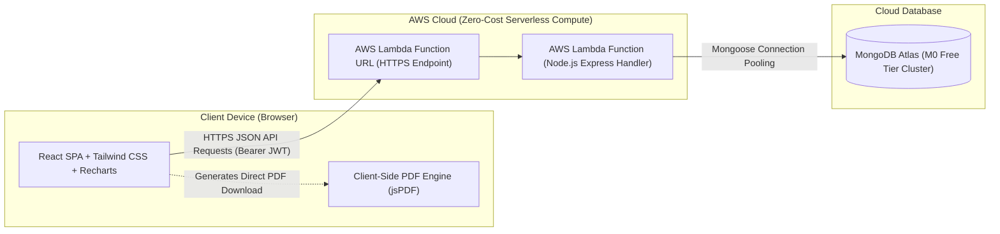

# CloudSpend — Smart Expense Management & Budget Tracking

> **Enterprise Personal Finance SaaS Platform**  
> **Architecture:** Serverless Full-Stack (React SPA + AWS Lambda Function URL + MongoDB Atlas)

---

## 1. Project Overview

**CloudSpend** is a lightweight, secure personal financial ledger and budget monitoring web application. It is engineered specifically to help individuals track day-to-day expenditures, establish proactive monthly spending limits, visualize financial habits, and generate verified, print-ready PDF expense statements directly within the web browser.

### Key Goals
- **Simplicity:** Accessible to everyday users without complex financial jargon.
- **Proactive Budgeting:** Automated warning thresholds triggered at **80%** (budget warning) and **100%** (overspending alert) based on actual stored expenses.
- **Low Operating Cost:** Minimal cloud footprint using scale-to-zero compute and free database tiers.
- **Strict Data Isolation:** Multi-tenant cryptographic security using bcrypt hashing and signed JWT validation.
- **Client-Side PDF Engine:** On-demand statements compiled locally in-browser via `jsPDF` and `jspdf-autotable` without cloud storage fees.

---

## 2. Cloud Architecture



### Architectural Principles
1. **Single AWS Compute Service:** Utilizes **AWS Lambda Function URL** directly for HTTPS routing, eliminating Amazon API Gateway, EC2, NAT Gateways, and Application Load Balancers.
2. **Zero Server-Side Storage:** PDF reports are assembled in the browser DOM, eliminating Amazon S3 bucket storage, bandwidth costs, and server-side PDF generation overhead.
3. **Database Connection Reuse:** The backend leverages connection caching across warm Lambda container invocations to avoid exhausting database sockets.

---

## 3. Technology Stack

| Layer | Technologies |
| :--- | :--- |
| **Frontend** | React 19, TypeScript, Vite, Tailwind CSS v4, React Router v7 |
| **Data Visualization** | Recharts (Area charts, Donut charts, Bar comparisons) |
| **Icons & UI** | Lucide React, Custom accessible modals & toast notifications |
| **Document Generation** | jsPDF & jspdf-autotable (100% browser-based) |
| **Backend & Compute** | Node.js, Express-compatible router, AWS Lambda, `@vendia/serverless-express` |
| **Database** | MongoDB Atlas (M0 Free Tier), Mongoose with compound indexing |
| **Security & Auth** | bcryptjs password hashing (10 salt rounds), JSON Web Tokens (JWT) |

---

## 4. Project Directory Structure

```text
cloudspend/
├── server/                           # Serverless backend & models
│   ├── config/
│   │   └── db.ts                     # MongoDB Atlas connection with Lambda warm cache
│   ├── controllers/
│   │   ├── authController.ts         # User registration, login, profile, password change
│   │   ├── expenseController.ts      # Expense CRUD with verified tenant ownership
│   │   ├── budgetController.ts       # Monthly budget retrieval and upsert
│   │   └── dashboardController.ts    # Aggregated metrics & rule-based analytics
│   ├── middleware/
│   │   └── authMiddleware.ts         # JWT bearer verification
│   ├── models/
│   │   ├── User.ts                   # User schema with unique email index
│   │   ├── Expense.ts                # Expense schema with user + date compound index
│   │   └── Budget.ts                 # Budget schema with user + month + year index
│   ├── services/
│   │   └── dbFallback.ts             # In-memory database store for dev & offline demo
│   ├── app.ts                        # Express API definitions & CORS configuration
│   └── lambda.ts                     # AWS Lambda Function URL entry point
├── src/                              # Frontend React application
│   ├── components/
│   │   ├── common/                   # Navbar, AppHeader, AppSidebar, Modal, Dialogs
│   │   ├── dashboard/                # StatCard, SpendingTrendsChart, Donut, Insights
│   │   ├── expenses/                 # ExpenseFormModal, ExpenseFilterBar, ExpenseTable
│   │   ├── budgets/                  # BudgetManager and category breakdown
│   │   ├── reports/                  # PdfReportModal with date range filtering
│   │   ├── settings/                 # Account settings & currency preference
│   │   └── landing/                  # Landing page modular sections
│   ├── context/
│   │   ├── AuthContext.tsx           # Authentication state & 1-click demo login
│   │   ├── ThemeContext.tsx          # Light & dark theme persistent provider
│   │   └── ToastContext.tsx          # Accessible feedback toasts
│   ├── pages/                        # LandingPage, LoginPage, RegisterPage, Dashboard, etc.
│   ├── services/
│   │   ├── api.ts                    # REST client with offline resilience
│   │   └── pdfGenerator.ts           # jsPDF client-side statement generator
│   ├── types/
│   │   └── index.ts                  # Core TypeScript interfaces
│   ├── utils/
│   │   └── formatters.ts             # Currency, date, and category styling helpers
│   ├── App.tsx                       # React Router configuration & protected routes
│   └── main.tsx                      # React root entry point
├── server.ts                         # Dev & production full-stack server
├── .env.example                      # Configuration template
├── package.json
└── tsconfig.json
```

---

## 5. Local Development Setup

### Prerequisites
- Node.js (v18.x or v20.x recommended)
- npm or pnpm

### Step 1: Clone and Install
```bash
npm install
```

### Step 2: Configure Environment Variables
Copy `.env.example` to `.env`:
```bash
cp .env.example .env
```
Fill in the configuration parameters (see below). If `MONGODB_URI` is left blank, CloudSpend will automatically run with the built-in in-memory fallback engine so you can evaluate the complete app immediately!

### Step 3: Run the Development Server
```bash
npm run dev
```
Open [http://localhost:3000](http://localhost:3000) in your browser. Both the React frontend and Express backend run together on port 3000 via Vite middleware.

---

## 6. MongoDB Atlas Setup

1. Create a free account at [mongodb.com/atlas](https://www.mongodb.com/atlas).
2. Create a free **M0 Sandbox cluster** in your nearest cloud region.
3. In **Database Access**, create a database user (e.g. `cloudspend_admin`) and generate a secure password.
4. In **Network Access**, add IP address `0.0.0.0/0` (allow access from anywhere) so that AWS Lambda container instances can reach the cluster.
5. In **Database > Connect > Drivers**, copy the connection string and update `.env`:
   ```env
   MONGODB_URI="mongodb+srv://cloudspend_admin:<PASSWORD>@cluster0.abcde.mongodb.net/cloudspend?retryWrites=true&w=majority"
   ```

---

## 7. AWS Lambda Deployment Instructions

Deploying the backend to AWS Lambda Function URL takes less than 5 minutes:

### Step 1: Build the Lambda Package
In the project directory, bundle the server files:
```bash
# Compile TypeScript to JavaScript
npx tsc -p tsconfig.json

# Bundle lambda handler with dependencies
zip -r lambda-deployment.zip dist server node_modules package.json
```

### Step 2: Create the Lambda Function in AWS Console
1. Log in to the [AWS Management Console](https://console.aws.amazon.com/lambda/).
2. Select **Create function** > **Author from scratch**.
3. Function name: `cloudspend-api`
4. Runtime: **Node.js 20.x**
5. Architecture: **x86_64** or **arm64**
6. Click **Create function**.

### Step 3: Upload Code and Configure Handler
1. In the **Code** tab, select **Upload from** > **.zip file** and upload `lambda-deployment.zip`.
2. Under **Runtime settings**, set the handler to:
   ```text
   server/lambda.handler
   ```

### Step 4: Configure Lambda Environment Variables
Go to **Configuration** > **Environment variables** > **Edit**:
- `MONGODB_URI`: Your MongoDB Atlas URI.
- `JWT_SECRET`: A long random secret string.
- `NODE_ENV`: `production`
- `CLIENT_ORIGIN`: Your frontend URL (e.g. `https://cloudspend.vercel.app` or `*`).

### Step 5: Enable Lambda Function URL
1. Go to **Configuration** > **Function URL** > **Create function URL**.
2. Auth type: **NONE** (public HTTPS access).
3. Configure CORS:
   - Allow Origin: `*` (or your frontend domain).
   - Allow Methods: `GET, POST, PUT, DELETE, OPTIONS`.
   - Allow Headers: `Content-Type, Authorization`.
4. Save and copy the generated URL:
   `https://<unique-id>.lambda-url.<region>.on.aws/`

---

## 8. Frontend Deployment (Vercel / Netlify / Static Cloud)

1. Build the production bundle:
   ```bash
   npm run build
   ```
2. The output directory is `./dist`.
3. In Vercel or Netlify:
   - Build Command: `npm run build`
   - Output Directory: `dist`
   - Add Environment Variable:
     ```env
     VITE_API_BASE_URL="https://<unique-id>.lambda-url.<region>.on.aws"
     ```

---

## 9. Security & Multi-Tenant Data Isolation

### User Isolation Verification
Every expense and budget operation explicitly filters by `req.user.id` derived from the verified JWT payload:
- **No Spoofing:** The frontend cannot pass an arbitrary `userId` to read or mutate another user's data.
- **Ownership Check:** Updating or deleting an expense requires both `_id` and `userId` to match:
  ```typescript
  const result = await Expense.findOneAndDelete({ _id: id, userId });
  if (!result) return res.status(404).json({ message: "Record not found or access denied." });
  ```

### Password Protection
- Passwords are salted with 10 rounds using `bcryptjs`.
- Plaintext passwords are never stored in databases or printed in server logs.

---

## 10. Cost-Minimization & AWS Free-Tier Notice

### Architecture Cost Strategy
- **AWS Lambda:** Provides 1 million free invocations and 3.2 million seconds of compute time per month on the AWS Free Tier.
- **Function URL:** Free HTTPS endpoint — completely replaces the monthly cost of an API Gateway or Application Load Balancer.
- **MongoDB Atlas:** The M0 Free Tier provides 512 MB of persistent cloud storage with zero charges.
- **Client-Side PDF:** Reports are generated inside the user's browser, eliminating Amazon S3 and compute fees.

### Important Notice for AWS & Cloud Deployment
> Free-tier availability, resource limits, and charges depend on your AWS account age, regional eligibility, and current provider terms. We recommend creating an **AWS Billing Alert** set at $1.00 to receive instant email notifications if limits are approached.

---

## 11. Verification Checklist

- [x] Register new user account with email and password confirmation
- [x] Sign in with JWT issuance and automatic session persistence
- [x] Access protected dashboard and ledger only when authenticated
- [x] Record expenses with positive amount, category, date, and payment method
- [x] Edit and update expense records
- [x] Delete expenses with confirmation modal
- [x] Real-time search by description/notes, filter by category, payment method, and date range
- [x] Set and update monthly budgets
- [x] Verify budget progress bar warning states (80% amber threshold, 100% crimson overage)
- [x] Recharts daily spending trend and category breakdown visualization
- [x] Rule-based spending insights derived from real stored transactions
- [x] Client-side PDF export with jsPDF for current month, previous month, all-time, or custom dates
- [x] Responsive layout on desktop (sidebar), tablet, and mobile (collapsible drawer)
- [x] Light and dark mode with persistent user preference
- [x] Data isolation: User A cannot read, edit, or delete User B's records
- [x] Production serverless AWS Lambda Function URL adapter ready
