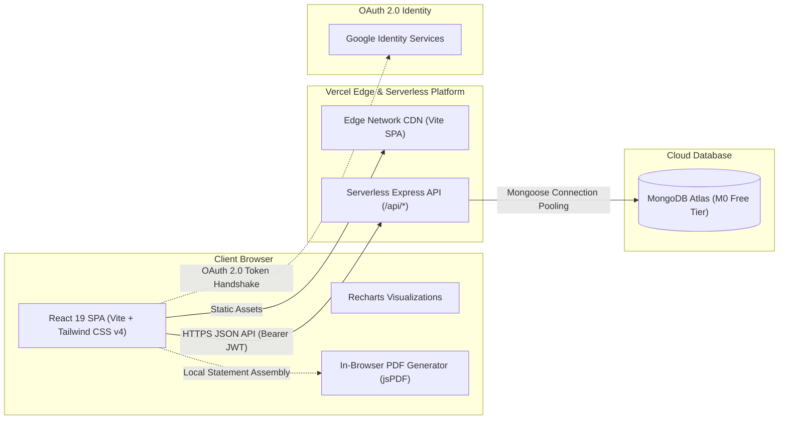

# CloudSpend — Smart Expense Management & Budget Tracking

> **Modern Full-Stack Personal Finance Platform**  
> **Architecture:** Serverless Full-Stack (React 19 + Vite SPA + Express API on Vercel Serverless + MongoDB Atlas)

---

## 🌟 Project Overview

**CloudSpend** is an elegant, secure personal financial ledger and budget monitoring web application. It empowers individuals to manage day-to-day expenditures, track multi-wallet balances, monitor recurring payments, maintain proactive monthly budget limits, visualize spending trends, and export verified, print-ready PDF statements directly within the web browser.

### ✨ Key Features
- **📊 Interactive Financial Dashboard:** Real-time net balance, monthly income, expense breakdowns, and visual budget utilization gauges.
- **💳 Multi-Wallet Management:** Track cash, credit cards, bank accounts, and investments with individual balances.
- **⚡ Proactive Budget Alerts:** Visual status indicators with automated warnings at **80%** (budget warning) and **100%** (overspending alert).
- **🔁 Recurring Payments:** Track subscriptions, utility bills, and auto-renewals with due-date tracking and 1-click payment logging.
- **📄 Client-Side PDF Statements:** On-demand export with custom date filters and category breakdowns rendered locally in the browser via `jsPDF` (zero server bandwidth/storage cost).
- **🔐 Dual Authentication:** Secure Email/Password authentication with salted bcrypt hashing and 1-Click **Google OAuth 2.0** integration.
- **🌓 Dark & Light Modes:** Smooth theme switching with persistent user preference storage.
- **📱 Responsive & Accessible:** Built with mobile-first design, fluid glassmorphism, and smooth scroll-to-top micro-interactions.

---

## 🏗️ Architecture



---

## 💻 Tech Stack

| Layer | Technologies |
| :--- | :--- |
| **Frontend** | React 19, TypeScript, Vite, Tailwind CSS v4, React Router v7 |
| **Data Visualization** | Recharts (Area charts, Donut charts, Bar comparisons) |
| **Icons & Micro-animations** | Lucide React, Framer Motion-compatible transitions |
| **Document Generation** | jsPDF & jspdf-autotable (100% browser-based) |
| **Backend & Compute** | Node.js, Express, Vercel Serverless Functions (`api/index.ts`) |
| **Database & ODM** | MongoDB Atlas, Mongoose (with in-memory fallback store) |
| **Authentication & Security** | JWT (JSON Web Tokens), bcryptjs, Google Identity Services OAuth 2.0 |
| **Deployment** | Vercel (Frontend CDN + Serverless API Functions) |

---

## 📁 Repository Structure

```text
cloudspend/
├── api/
│   └── index.ts                  # Vercel Serverless Function entry point
├── public/
│   ├── cloudspend_logo.svg       # Brand icon asset
│   └── favicon.svg               # Web favicon
├── server/
│   ├── config/
│   │   └── db.ts                 # MongoDB Atlas connection manager & pool
│   ├── controllers/              # REST API controllers (Auth, Expenses, Wallets, Budgets, etc.)
│   ├── middleware/               # JWT authentication middleware
│   ├── models/                   # Mongoose data schemas (User, Expense, Wallet, Budget, etc.)
│   ├── services/                 # Fallback in-memory database store
│   └── app.ts                    # Express application configuration & routes
├── src/
│   ├── components/               # UI components (auth, common, dashboard, landing, modals)
│   ├── context/                  # React contexts (AuthContext, ThemeContext, ToastContext)
│   ├── pages/                    # Application pages (Landing, Login, Register, Dashboard, etc.)
│   ├── services/                 # Frontend API client with fetch interceptor
│   ├── types/                    # TypeScript interfaces & types
│   ├── utils/                    # Formatters, currency symbols, and helpers
│   ├── App.tsx                   # Main React application router
│   ├── index.css                 # Tailwind CSS v4 styling rules
│   └── main.tsx                  # React DOM entry point
├── .env.example                  # Environment variable reference template
├── .gitignore                    # Git ignore file (safeguards .env)
├── package.json                  # Dependencies and build scripts
├── server.ts                     # Local full-stack Express + Vite dev server
├── tsconfig.json                 # TypeScript compiler configuration
├── vercel.json                   # Vercel deployment rewrites configuration
└── vite.config.ts                # Vite build and plugin configuration
```

---

## 🚀 Getting Started Locally

### 1. Prerequisites
- **Node.js**: v18.0.0 or higher (v20+ recommended)
- **npm**: v9+ (packaged with Node.js)

### 2. Clone and Install
```bash
git clone https://github.com/<YOUR_GITHUB_USERNAME>/cloudspend.git
cd cloudspend

# Install dependencies
npm install
```

### 3. Configure Environment Variables
Copy `.env.example` to create your local `.env`:
```bash
cp .env.example .env
```

Edit `.env` with your credentials:
```properties
# MongoDB Atlas Connection String
# (Leave empty to automatically use the built-in in-memory database fallback)
MONGODB_URI="mongodb+srv://<username>:<password>@cluster0.abcde.mongodb.net/cloudspend?retryWrites=true&w=majority"

# JWT Secret for signing session tokens
JWT_SECRET="your_secure_random_jwt_secret_here"

# Google OAuth 2.0 Client ID (from Google Cloud Console)
VITE_GOOGLE_CLIENT_ID="your-client-id.apps.googleusercontent.com"
GOOGLE_CLIENT_ID="your-client-id.apps.googleusercontent.com"

# Local Server Configuration
PORT=3000
VITE_API_URL=""
CLIENT_ORIGIN="http://localhost:3000"
NODE_ENV="development"
```

### 4. Start Development Server
```bash
npm run dev
```

Visit **[http://localhost:3000](http://localhost:3000)** in your browser.

---

## ☁️ Deploying to Vercel

CloudSpend is fully configured for one-click deployment on **Vercel** with zero-configuration serverless functions.

### Step 1: Push Code to GitHub
```bash
git init
git add .
git commit -m "feat: initial commit for Vercel deployment"
git branch -M main
git remote add origin https://github.com/<YOUR_GITHUB_USERNAME>/cloudspend.git
git push -u origin main
```

### Step 2: Import into Vercel
1. Go to **[vercel.com](https://vercel.com)** and log in.
2. Click **Add New...** ➔ **Project**.
3. Select your **`cloudspend`** repository from GitHub and click **Import**.
4. Vercel automatically detects the Vite configuration:
   - **Framework Preset**: `Vite`
   - **Build Command**: `vite build`
   - **Output Directory**: `dist`
   - **Root Directory**: `./`

### Step 3: Add Environment Variables in Vercel
In the project setup page, expand **Environment Variables** and add:

| Key | Description / Example |
| :--- | :--- |
| `MONGODB_URI` | `mongodb+srv://<user>:<password>@cluster.mongodb.net/cloudspend?...` |
| `JWT_SECRET` | A secure string for JWT encryption |
| `GOOGLE_CLIENT_ID` | Your Google OAuth 2.0 Web Client ID |
| `VITE_GOOGLE_CLIENT_ID` | Same Google OAuth 2.0 Web Client ID |
| `NODE_ENV` | `production` |
| `CLIENT_ORIGIN` | Leave blank or set to your Vercel URL |

5. Click **Deploy**.

---

## 🔑 Google Cloud OAuth 2.0 Setup

To enable 1-Click **Continue with Google** sign-in:

1. Go to the **[Google Cloud Console](https://console.cloud.google.com/apis/credentials)**.
2. Create or select an existing project.
3. Configure the **OAuth Consent Screen** (User Type: External).
4. Under **Credentials** ➔ **Create Credentials** ➔ **OAuth Client ID**:
   - **Application Type**: *Web application*
   - **Name**: `CloudSpend Web Client`
   - **Authorized JavaScript origins**:
     - `http://localhost:3000` (for local development)
     - `http://localhost`
     - `https://your-project.vercel.app` (your production Vercel URL)
   - **Authorized redirect URIs**:
     - `http://localhost:3000`
     - `https://your-project.vercel.app`
5. Copy your **Client ID** into `.env` (as `VITE_GOOGLE_CLIENT_ID` and `GOOGLE_CLIENT_ID`) and into your Vercel Environment Variables.

---

## 🍃 MongoDB Atlas Configuration

1. Create a free cluster on **[MongoDB Atlas](https://www.mongodb.com/cloud/atlas)**.
2. Under **Database Access**, create a user with `Read and write to any database` privileges.
3. Under **Network Access**, click **Add IP Address** and select `Allow Access from Anywhere` (`0.0.0.0/0`) so Vercel's serverless functions can connect.
4. Click **Connect** ➔ **Drivers** (Node.js) and copy the connection string into your `MONGODB_URI`.

---

## 🧪 Available Scripts

| Command | Action |
| :--- | :--- |
| `npm run dev` | Runs the full-stack app with hot reloading on `http://localhost:3000` |
| `npm run build` | Compiles production assets with Vite into `dist/` |
| `npm start` | Runs the production server with pre-built assets |
| `npm run lint` | Runs TypeScript type checking without emitting files |
| `npm run clean` | Removes compiled distribution directories |

---

## 📄 License
This project is open source and available under the [MIT License](LICENSE).
